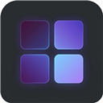

<p align="center">
  
</p>

<h1 align="center">Refined Speed Dial</h1>

<p align="center">
  <strong>Replace your cluttered New Tab page with a fast, customizable Speed Dial featuring drag-and-drop folders, custom wallpapers, and cross-device sync.</strong>
</p>

<p align="center">
  
  
  
  
</p>

---

## 💡 Why Refined Speed Dial?

Default browser New Tab pages are either too limited (restricting you to a handful of auto-generated shortcuts) or overloaded with news feeds, sponsored cards, and crypto widgets you never asked for.

**Refined Speed Dial** gives you a clean, distraction-free launchpad every time you press `Ctrl + T`. Organize dozens of bookmarks into visual **folders**, customize your **wallpaper** and **accent color**, interact via a custom right-click **context menu**, and keep your layout synchronized across devices via `chrome.storage.sync` (with automatic fallback to `chrome.storage.local`).

---

## ✨ What It Proposes & Key Features

- 🗂️ **Visual Shortcuts & Folders:** Group related sites into folders with live 2×2 mini-icon previews. Drag and drop shortcuts into folders—or drag them out to the drop zone to ungroup.
- 🎨 **Deep Visual Customization:** Upload your own high-resolution wallpaper (`PNG`, `JPEG`, `WebP`), choose how it scales (`Cover`, `Contain`, `Stretch`, `Center`), and customize the UI accent color to match your setup.
- 🖱️ **Native-Feeling Custom Context Menus:** Right-click any shortcut or folder to Edit, Delete, Reorder, or move directly into another folder; right-click anywhere on the canvas to quickly add a shortcut or customize the theme.
- ☁️ **Smart Cross-Device Sync:** Automatically syncs your Speed Dial structure across logged-in browsers via `chrome.storage.sync`, seamlessly falling back to `chrome.storage.local` if quota limits are exceeded.
- ♿ **Accessible by Design:** Built with semantic ARIA roles (`role="dialog"`, `aria-modal`), keyboard navigation (`Escape` to close modals/menus), and automatic focus restoration.

---

## ⚡ Install in 60 Seconds (No Coding Required)

Works on **Brave**, **Google Chrome**, **Microsoft Edge**, **Vivaldi**, and **Opera**:

1. **Download this repository:**
   - Click the green **Code** button above and select **Download ZIP** (then extract it), *or* clone via terminal:
     ```bash
     git clone https://github.com/gabzieg/brave-speed-dial.git
     ```
2. **Open your browser's Extensions page:**
   - Brave: `brave://extensions/`
   - Chrome: `chrome://extensions/`
   - Edge: `edge://extensions/`
3. **Enable Developer Mode:** Toggle the **Developer mode** switch in the top-right corner.
4. **Load the Extension:** Click **Load unpacked** (top-left) and select the `brave-speed-dial` folder.
5. **Open a New Tab (`Ctrl + T`):** Click the `⚙` gear icon in the corner or right-click anywhere on the background to add your first shortcuts and customize your wallpaper!

---

## 🛠️ How It Works Under the Hood

| File | Role |
| :--- | :--- |
| [`manifest.json`](manifest.json) | Manifest V3 configuration overriding `chrome_url_overrides.newtab` and requesting `storage` + `unlimitedStorage` (for local high-res wallpapers). |
| [`newtab.html`](newtab.html) | Accessible HTML5 structure containing the dial grid, folder overlay, shortcut editor modal, settings dialog, and custom context menus. |
| [`newtab.js`](newtab.js) | Zero-dependency Vanilla JS state engine managing drag-and-drop reordering, automatic favicon resolution, `chrome.storage.sync` / `local` persistence, and keyboard focus traps. |
| [`newtab.css`](newtab.css) | Glassmorphism-inspired dark UI powered by dynamic CSS custom properties (`--accent-color`, `--wallpaper-image`). |

---

## 📄 License

Distributed under the **MIT License** — see [`LICENSE`](LICENSE) for details.
